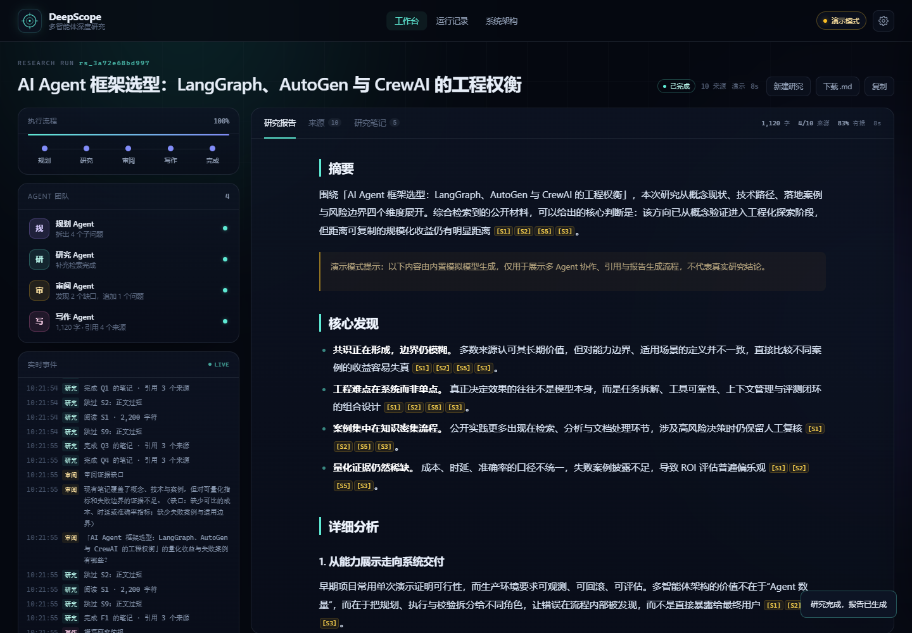
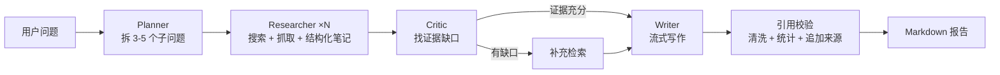

# DeepScope · 多智能体深度研究助手

> 让四个 Agent 协作，完成一次有据可查的深度研究。Planner 拆题，Researcher 并行检索与阅读，Critic 审阅证据缺口，Writer 流式写作并做引用校验。



DeepScope 是一个可以直接运行、可以现场演示的多 Agent 研究系统。输入一个开放问题，四个角色分工协作，前端实时展示检索、阅读、笔记、审阅与写作过程；最终报告中的每条关键结论都带可点击的 `[S#]` 来源编号，能回溯到原文链接。

这个项目的重点不是"再包一层 Agent 框架"，而是把 **编排、事件流、引用闭环、降级策略** 这四件在真实产品里最容易出问题的事做扎实。

## 功能一览

- **四个 Agent 角色**：规划、研究、审阅、写作，各自有独立提示词与结构化输出约束。
- **实时事件流**：搜索、抓取、阅读、笔记、审阅、token 流、引用校验全程可见；支持断线重连与事件去重。
- **并行研究**：子问题并发执行，全局来源编号 `S1..Sn` 稳定分配，同一 URL 自动去重。
- **引用闭环**：写作只允许引用已注册来源；结束后清洗无效编号，计算 `grounded_ratio`、`source_coverage`，并自动追加规范参考来源。
- **降级优先**：Tavily → 360 → 搜狗 → Bing → 离线多级搜索；单页抓取失败不影响其他来源；模型流式失败自动回退非流式；单子问题失败被隔离。
- **演示模式**：没有 API Key 也能跑完整流程（内置 Mock 模型 + 真实搜索/抓取），报告明确标注演示数据，界面有醒目标识。
- **可演示的 UI**：工作台、实时日志、来源卡片、研究笔记、运行历史、模型设置、系统架构说明、Markdown 导出。
- **可复现的评测与测试**：17 个单元/集成测试、离线评测脚本与指标报告。

## 60 秒跑起来

要求 Python 3.11+，Windows 直接双击 `run.bat` 即可（自动检查依赖，缺失时用阿里云镜像安装）。

也可以手动启动：

```bash
pip install -r requirements.txt -i https://mirrors.aliyun.com/pypi/simple/
python run.py
```

打开 <http://127.0.0.1:8765>。未配置 API Key 时自动进入演示模式：搜索与抓取仍然真实执行，报告由内置模拟模型生成，内容与判断不代表真实研究结论。

## 接入真实模型

任选一种方式：

1. **页面设置**：右上角齿轮 → 填 Base URL / 模型名 / API Key → "测试并保存"。Key 只保存在服务进程内存中，不写入磁盘。
2. **.env 文件**：复制 `.env.example` 为 `.env`，填入 `LLM_API_KEY`。支持任意 OpenAI 兼容接口：

| 服务 | Base URL | 模型示例 |
|---|---|---|
| DeepSeek | `https://api.deepseek.com/v1` | `deepseek-chat` |
| 通义千问 | `https://dashscope.aliyuncs.com/compatible-mode/v1` | `qwen-plus` |
| OpenAI | `https://api.openai.com/v1` | `gpt-4o-mini` |

搜索默认使用免 Key 的 360 搜索，可选搜狗、Bing RSS、Tavily 或离线数据。若本机需要代理访问外网，在 `.env` 中设置 `HTTP_PROXY`。

## 它是怎么工作的



一次运行分为五个阶段：规划（6%）→ 并行研究（22%）→ 审阅（62%）→ 写作（80%）→ 完成（100%）。每个阶段通过 SSE 推送 `stage` / `agent_status` / `question` / `search` / `source` / `reading` / `note` / `critique` / `token` / `citation_check` / `report` / `done` 等事件，前端按 `seq` 去重并渲染时间线。

### 引用闭环

1. 检索结果进入 `SourceRegistry`，按 URL 去重后分配稳定编号 `S1..Sn`。
2. Researcher 的笔记必须带 `source_ids`，正文用 `[S#]` 引用；抓取失败的来源会被标注、不进入引用池。
3. Writer 只拿到来源清单与笔记，提示词要求"每个关键判断至少一个引用，不要自己编参考列表"。
4. 写作结束后：移除模型自造的来源段 → 清洗无效编号 → 计算引用统计 → 追加规范参考来源。
5. 统计口径：`grounded_ratio` = 正文内容行中有有效引用的比例；`source_coverage` = 被引用的不同来源数 / 有效来源数；参考来源列表本身不计入正文行。
6. 前端把正文中的 `[S#]` 转成可点击 chip，点击后跳到对应来源卡片并高亮。

### 为什么不用 LangGraph

这个系统的拓扑是"固定四角色 + 审阅触发一轮补充检索"，不是任意图。自己写编排器约 200 行，换来三个好处：事件模型完全可控（SSE 事件与 Agent 生命周期一一对应）、失败隔离更直观（单个子问题异常不会拖垮整次运行）、面试时能逐行讲清楚每个调度决策。框架不是目的，可解释的工程取舍才是。

更多设计细节见 [docs/ARCHITECTURE.md](docs/ARCHITECTURE.md)。

## 评测

`eval/` 提供了一个可复现的评测脚本，默认离线运行（Mock 模型 + 离线搜索 + 模拟抓取），衡量的是流程指标与引用纪律，而不是答案正确性：

```bash
python eval/run_eval.py --offline
```

示例结果（6 个问题，2026-11）：

| 指标 | 结果 |
|---|---|
| 成功率 | 6 / 6 |
| 平均用时 | 2.4s |
| 平均来源数 | 8.7 |
| 平均引用来源 | 4.0 |
| 平均有据率 | 83% |
| 引用编号异常 | 0 |

完整表格见 [eval/report.md](eval/report.md)。接真实模型后可去掉 `--offline`，用同一套指标做回归对比。真实产品还应叠加人工评分或 LLM-as-judge，这部分我在报告里明确标注为"流程指标"而不是"质量结论"。

## 测试

```bash
python -m unittest discover -s tests -v
```

覆盖引用解析与清洗、统计口径、来源注册并发去重、SSRF 防护、HTML 正文提取与编码回退、持久化、Mock 全流程、单子问题失败隔离，共 17 个测试。

## 项目结构

```
deepscope/
├─ app/
│  ├─ orchestrator.py     # 五阶段编排、并发控制、失败隔离
│  ├─ llm.py              # OpenAI 兼容客户端 + Mock 模型
│  ├─ models.py           # Run / SourceRegistry / 事件总线
│  ├─ server.py           # FastAPI + SSE + 设置 + 历史 + 导出
│  ├─ store.py            # 运行记录 JSON 持久化
│  ├─ agents/             # planner / researcher / critic / writer
│  └─ tools/              # search / fetch / citations
├─ web/                   # 原生 JS + SSE 前端（无构建步骤）
├─ eval/                  # 评测问题集与脚本
├─ tests/                 # unittest
├─ data/runs/             # 运行记录（演示数据）
├─ docs/                  # 架构、面试讲解、截图
├─ run.py / run.bat
└─ requirements.txt
```

## API

| 方法 | 路径 | 说明 |
|---|---|---|
| GET | `/api/health` | 健康检查与当前模式 |
| GET | `/api/config` | 公开配置（不含 Key） |
| POST | `/api/settings` | 运行时配置模型/搜索，保存前做一次连通性测试 |
| POST | `/api/research` | 创建研究任务 |
| GET | `/api/runs` | 运行历史 |
| GET | `/api/runs/{id}` | 运行快照（报告/来源/笔记/统计） |
| GET | `/api/runs/{id}/events` | SSE 事件流，支持重放与断线重连 |
| POST | `/api/runs/{id}/cancel` | 取消运行 |
| GET | `/api/runs/{id}/report.md` | 下载 Markdown 报告 |

## 已知限制

- 演示模式的报告是模板化内容，只用于展示流程与引用机制；接入真实模型后才有研究价值。
- 360 / 搜狗为网页解析，可能触发限流；系统会自动降级到下一个搜索源。
- 当前是单机单进程、无登录鉴权，适合本地演示与作品集，不适合直接暴露到公网。
- 评测指标衡量引用纪律与主题覆盖，不衡量事实正确性；生产场景需要人工评分、事实核验与回归集。
- 长报告在流式阶段按 90ms 节流渲染，超大文档（>5 万字）建议改为分段渲染或虚拟列表。

## 面试讲解

- [docs/INTERVIEW.md](docs/INTERVIEW.md)：30 秒介绍、2 分钟演示脚本、5 分钟架构讲解、常见追问与回答。
- [docs/ARCHITECTURE.md](docs/ARCHITECTURE.md)：模块职责、事件协议、并发与失败模型、关键取舍。
