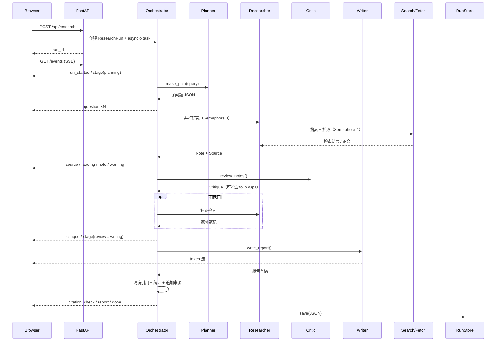

# DeepScope 架构说明

本文记录 DeepScope 的内部结构、关键数据流与工程取舍，方便二次开发或面试讲解。

## 1. 总览

DeepScope 是一个单进程的异步研究服务：FastAPI 负责 HTTP 与 SSE，`Orchestrator` 负责一次研究任务的五阶段编排，四个 Agent 各自封装提示词与结构化输出，工具层负责搜索、抓取与引用校验，`RunStore` 负责把运行结果落盘。

```
Browser
  │  POST /api/research
  ▼
FastAPI ──► RunManager ──► Orchestrator ──► Planner
  │                            │            Researcher ×N ──► SearchTool ──► 360 / Sogou / Bing / Tavily
  │                            │            Critic              PageFetcher ──► HTTP + 正文提取
  │                            │            Writer              LLMClient ──► OpenAI 兼容接口
  │  SSE /api/runs/{id}/events  │
  ▼                            ▼
前端事件渲染 ◄──────────── ResearchRun 事件总线 ──► RunStore（JSON）
```

前端没有构建步骤：原生 JS、`marked` + `DOMPurify` 本地 vendor，SSE 使用浏览器原生 `EventSource`。

## 2. 模块职责

| 模块 | 职责 |
|---|---|
| `app/config.py` | 环境变量与运行时配置；有 Key 为 live，无 Key 自动 mock |
| `app/models.py` | `ResearchRun`、`SourceRegistry`、`Source`/`Note`/`Critique`、事件总线、JSON 容错解析 |
| `app/llm.py` | OpenAI 兼容客户端：endpoint 归一化、重试、流式解析、用量统计、Mock 模型 |
| `app/agents/planner.py` | 拆分子问题，输出 JSON；失败使用固定模板兜底 |
| `app/agents/researcher.py` | 搜索 → 域名多样化 → 注册来源 → 抓取 → 生成结构化笔记 |
| `app/agents/critic.py` | 审阅笔记，输出 verdict / gaps / followups |
| `app/agents/writer.py` | 基于笔记流式写作；流式失败时回退非流式 |
| `app/tools/search.py` | 多搜索源与降级链、结果清洗、相关性检查、缓存 |
| `app/tools/fetch.py` | SSRF 防护、大小限制、编码回退、正文提取、页面缓存 |
| `app/tools/citations.py` | 引用提取/清洗/统计/参考来源追加 |
| `app/orchestrator.py` | 五阶段编排、并发信号量、异常隔离、保存结果 |
| `app/server.py` | REST、SSE、设置、历史、取消、下载、静态资源 |
| `app/store.py` | 原子写 JSON、列表排序、ID 校验 |
| `web/` | 首页、工作台、事件时间线、报告/来源/笔记、设置、历史、架构弹窗 |

## 3. 一次运行的时序



关键点：`report` 事件（最终完整报告）发生在 `done` 之前；前端收到 `report` 后取消 token 的节流渲染，避免"最后一批 token 覆盖最终报告"的竞态。

## 4. 事件协议

| 事件 | 主要字段 | 用途 |
|---|---|---|
| `run_started` | mode / model / query | 初始化运行 |
| `stage` | stage / label / progress | 五阶段进度 |
| `agent_status` | status / detail | Agent 卡片状态 |
| `question` | question{id,question,kind} | 子问题 chip |
| `search` | query / provider / count | 检索日志 |
| `source` | source{id,title,url,domain,fetched} | 来源卡片 |
| `reading` | source_id / ok / chars | 抓取结果 |
| `note` | note{question_id,summary,key_points,source_ids} | 结构化笔记 |
| `critique` | verdict / gaps / followups | 审阅结果 |
| `warning` | message | 降级/跳过/失败提示 |
| `token` | text | 流式写作片段（不持久化、不重放） |
| `citation_check` | stats | 引用统计 |
| `report` | report / stats | 最终报告 |
| `done` | duration / stats / usage | 完成 |
| `error` / `cancelled` | message | 终态 |
| `stream_end` | — | SSE 结束哨兵 |

SSE 使用自增 `seq` 作为 `id`。重连时服务端重放事件，前端按 `seq` 去重；`token` 不重放（最终报告会单独发送），避免重连后重复拼接。`/api/runs/{id}/events` 对已落盘的历史运行也会重放并以 `stream_end` 结束。

## 5. 并发与失败模型

- **子问题并发**：`asyncio.Semaphore(3)`，避免同时打爆搜索源；每个子问题包在 `safe_research` 中，异常转为 warning + 空笔记，不阻塞其他子问题。
- **抓取并发**：`Semaphore(4)`，每个子问题只抓前 `fetch_top_k` 个页面；同一 URL 的 `Page`（含失败）会被缓存，避免多个 Agent 重复抓取。
- **页面限制**：流式读取上限 2.5MB；正文不足 80 字符判定失败；按 charset → utf-8 → gb18030 依次解码。
- **模型重试**：最多 3 次；部分服务不支持 `response_format` 时，400 后去掉该字段重试。
- **流式回退**：Writer 流式输出不足 400 字符且出现异常时，改用非流式请求；仍失败才抛出，由编排器兜底。
- **搜索降级**：单一 provider 抛错时按链式回退；最终回退离线演示来源，并在 UI 显示 warning。
- **进程级隔离**：单次运行 task 独立；取消通过 `task.cancel()`，捕获 `CancelledError` 后落盘 `cancelled` 状态。

## 6. 引用与统计

`SourceRegistry` 用 `asyncio.Lock` 保护编号分配，按 `url`（去 `#fragment`、去尾斜杠）去重，返回 `(Source, created)`。这保证多个 Researcher 并发时不会出现重复编号或跳号。

统计只扫描"正文内容行"：跳过标题、引用块、分隔线、表格、代码块和 `参考来源` 之后的列表；长度小于 12 字符的行忽略。`grounded_ratio` 的分母是内容行数，因此空报告或纯标题报告不会得到虚高的分数。

无效引用清洗采用正则替换为空白，并修复中文标点前的多余空格与孤立的逗号/分号。来源标题中的 `[` `]` 会被替换为全角括号，避免干扰 Markdown 链接与引用解析。

## 7. 安全

- **SSRF**：`ensure_public_url` 只允许 http/https，拒绝 URL 内凭据、localhost、`.local/.internal`、私网/回环/链路本地/保留地址；DNS 解析后再校验所有 A/AAAA 记录，超时 5 秒。
- **Markdown 注入**：前端使用 DOMPurify 清洗 marked 生成的 HTML；外部链接统一加 `target=_blank` 与 `rel=noopener noreferrer`。
- **Key 保护**：通过设置页提交的 API Key 只写入进程内 `Settings`，不落盘、不写日志、不回显（`public_dict` 只返回 `api_key_set` 布尔值）。
- **下载**：服务端只返回已生成报告，文件名固定前缀，不接受任意路径。

## 8. 取舍与后续

| 取舍 | 原因 | 后续 |
|---|---|---|
| 自定义编排而非 LangGraph | 拓扑固定、事件可控、易讲解 | 若出现分支/循环/人工审批，再引入图编排 |
| JSON 文件持久化 | 单机演示零依赖、可直接查看 | 多用户时换 Postgres + 任务队列 |
| 网页搜索解析 | 免 Key、开箱即用 | 生产环境优先官方 Search API |
| Mock 模式 | 无 Key 可演示、方便评测 | 真实模式已有完整路径，接 Key 即用 |
| 原生 JS 前端 | 无构建、易部署、方便阅读 | 复杂化后再迁移 React/Vue |

下一步最想补的是"事实级评测"：在现有引用统计之上，增加 claim 抽取、来源支持度判断与人工标注集，把"有引用"升级为"引用确实支持结论"。
